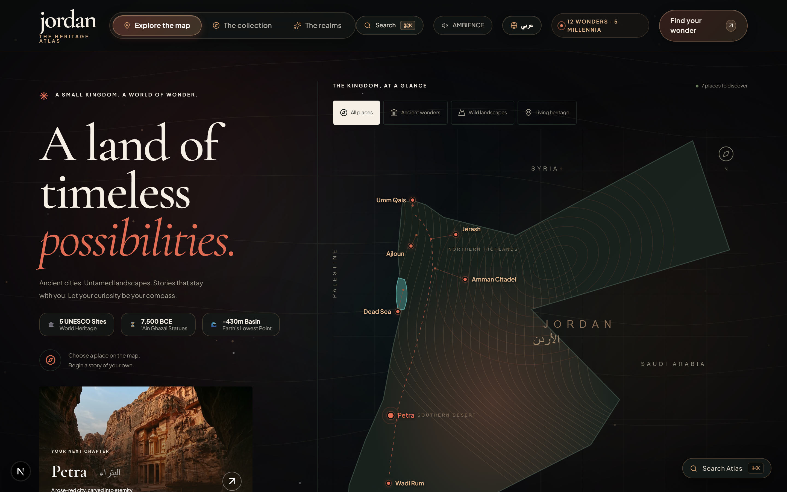
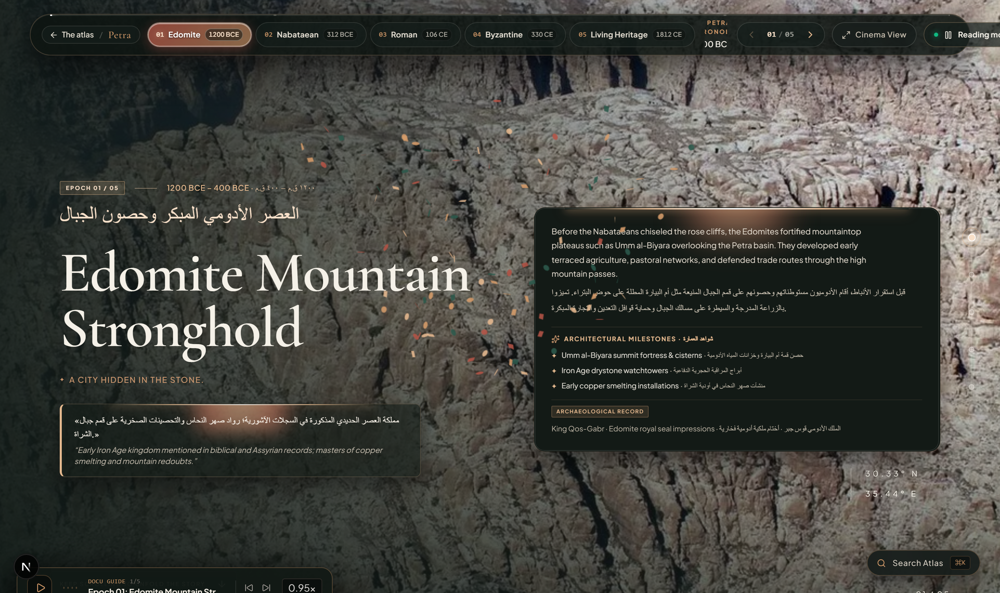
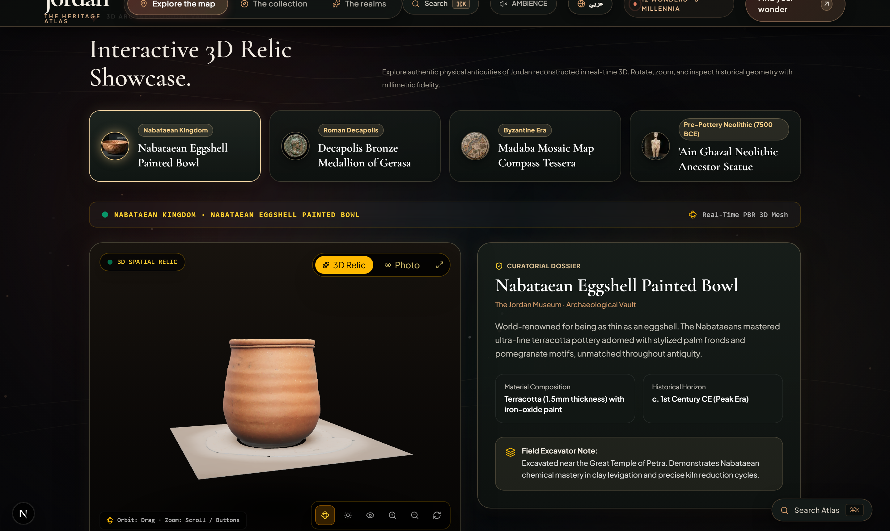
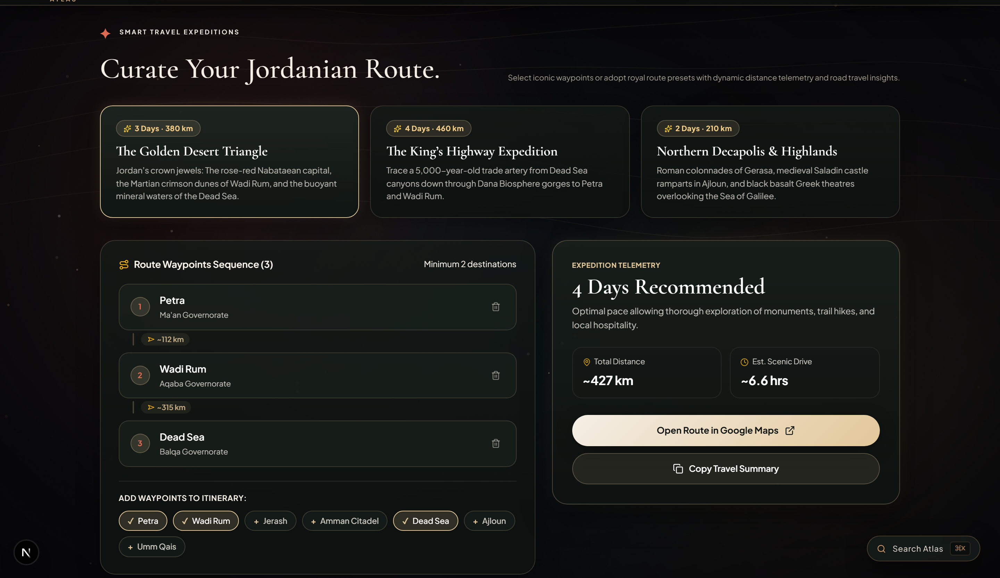
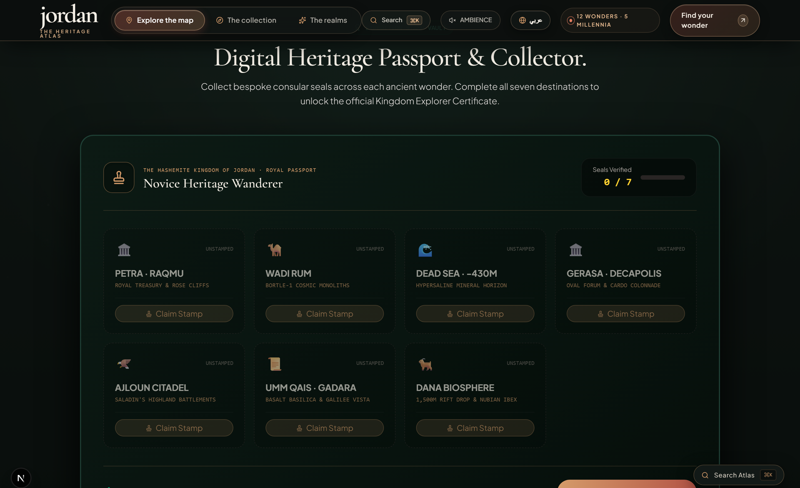
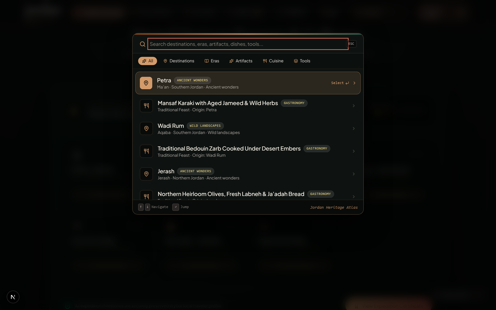

# 🇯🇴 Jordan — The Heritage Atlas
### *An Immersive Museum-Grade Digital Expedition across 12,000 Years of Civilization*

<p align="center">
  
</p>

<p align="center">
  <a href="https://nextjs.org/"></a>
  <a href="https://react.dev/"></a>
  <a href="https://www.typescriptlang.org/"></a>
  <a href="https://tailwindcss.com/"></a>
  <a href="https://threejs.org/"></a>
  <a href="https://greensock.com/"></a>
  <a href="https://vitest.dev/"></a>
  <a href="https://playwright.dev/"></a>
  <a href="https://www.w3.org/WAI/standards-guidelines/wcag/"></a>
</p>

<p align="center">
  <strong>An interactive archaeological documentary platform uniting 12,000 years of civilization, Nabataean hydraulic engineering, and Jordan's dramatic topography in an ultra-modern digital experience.</strong>
</p>

<p align="center">
  <a href="#-visual-tour--interface-showcase">Visual Tour</a> •
  <a href="#-core-features">Core Features</a> •
  <a href="#-3d--spatial-architecture">3D Architecture</a> •
  <a href="#-motion--performance-engineering">Motion & Performance</a> •
  <a href="#-technology-stack">Technology Stack</a> •
  <a href="#-getting-started--local-development">Getting Started</a> •
  <a href="#-testing--quality-assurance">Testing</a> •
  <a href="#-cultural-attribution--heritage-preservation">Heritage Preservation</a>
</p>

---

## 🏛️ Vision & Manifesto

**Jordan: The Heritage Atlas** redefines cultural tourism and digital heritage preservation by transcending conventional brochures and static websites. It introduces a unified museum-grade ecosystem combining **real-time spatial cartography**, **cinematic 5-epoch scrollytelling**, and **physically based 3D artifact examination (PBR WebGL)**.

Engineered to sustain a rock-solid **60 frames per second (60fps)**, the platform features complete bilingual support (English & Arabic with bidirectional layout flipping), strict adherence to digital accessibility standards (`WCAG 2.2 AAA`), and a bespoke visual design language inspired by the rose-red sandstone of Petra and the sweeping dunes of Wadi Rum.

---

## 📸 Visual Tour & Interface Showcase

### 1. Interactive Cartography & Topographic Map Gateway
A real-time vector projection map of the Hashemite Kingdom of Jordan calculated with high-precision geographic coordinates (`Latitude/Longitude`). Features distinct offset connector callouts for clustered northern landmarks (Jerash, Ajloun, Umm Qais), dynamic thematic route filters (*Ancient Wonders*, *Wild Nature*, *Living Heritage*), magnetic cursor proximity effects, and quick-launch command palette shortcuts (`⌘K`).

<p align="center">
  
</p>

---

### 2. Cinematic 5-Epoch Scrollytelling
A documentary scroll journey spanning thousands of years across pivotal archaeological landscapes (such as Petra). Powered by **GSAP ScrollTrigger** and an interactive **Vertical Era Scrubber Rail** featuring active pulsing gold nodes, bilingual epoch badges, one-click **Cinema Immersion Mode**, and synchronized speech narration.

<p align="center">
  
</p>

---

### 3. 3D Virtual Archaeological Relic Showcase
A museum-grade 3D artifact viewer built with **Three.js WebGL** featuring calibrated PBR materials (Nabataean Painted Ceramic Bowl, Decapolis Bronze Coin of Gerasa, Byzantine Madaba Mosaic, and Neolithic 'Ain Ghazal Statues). Includes 360° free orbit, microscopic zoom, an **Archaeological Raking Light** toggle to inspect surface carvings, and an expanded **3D Theater Modal**.

<p align="center">
  
</p>

---

### 4. Royal Routes Itinerary Workbench
An intelligent road trip planner calculating real-world driving distances, recommended exploration hours, and geographic sequencing across historical corridors (*Southern Golden Triangle*, *The King's Highway*, and *The Decapolis League*). Travelers can reorder waypoints dynamically and export turnkey routes directly to Google Maps.

<p align="center">
  
</p>

---

### 5. Digital Heritage Passport & Consular Stamps
A royal commemorative passport interface rendered in deep emerald and warm gold tones. Explorers unlock vintage consular heritage stamps with rubber-stamp spring physics upon discovering each site, accompanied by a downloadable and shareable official expedition certificate.

<p align="center">
  
</p>

---

### 6. Museum Command Palette (`Ctrl + K` / `⌘K`)
A frosted glass, keyboard-accessible command bar enabling instant search across all archaeological sites, historical epochs, 3D relics, and interactive planning tools in milliseconds with zero perceptible latency.

<p align="center">
  
</p>

---

## 🧭 Core Features

| Feature | Technical Architecture | Primary Component |
| :--- | :--- | :--- |
| **Interactive Cartography** | High-precision vector projection map with decluttered callout leader lines and `44×44px` touch targets | [`InteractiveMap.tsx`](src/components/InteractiveMap.tsx) |
| **Cinematic Scrollytelling** | 5-epoch narrative timeline with interactive vertical scrubber rail, GSAP pinning, and smooth cross-dissolves | [`Scrollytelling.tsx`](src/components/Scrollytelling.tsx) |
| **3D Artifact Showcase** | Three.js WebGL viewer with dielectric PBR calibration, PMREM RoomEnvironment, contact shadows, and raking light | [`ModelViewer3D.tsx`](src/components/ModelViewer3D.tsx) |
| **Living Canvas Background** | High-performance HTML5 canvas simulating topographical sand ripples with magnetic cursor dispersion physics | [`HeritageCanvasBackground.tsx`](src/components/ui/HeritageCanvasBackground.tsx) |
| **Generative Ambient Soundscape** | Procedural Web Audio API sound generator synthesizing desert winds, ripples, and canyon acoustics locally at 0KB payload | [`AmbientSoundscape.tsx`](src/components/AmbientSoundscape.tsx) |
| **Documentary Voice Narration** | Web Speech API synthesis engine in English and Arabic with intelligent background audio ducking | [`VoiceNarrationPlayer.tsx`](src/components/VoiceNarrationPlayer.tsx) |
| **Nabataean Script Translator** | Real-time script converter translating Latin and Arabic text into historic Nabataean Aramaic glyphs (22 vector runes) | [`NabataeanTranslator.tsx`](src/components/NabataeanTranslator.tsx) |
| **Solar Telemetry & Golden Hours** | Astronomical ephemeris algorithm calculating exact sunrise, sunset, blue hour, and golden photography windows per site | [`SolarTelemetryCard.tsx`](src/components/SolarTelemetryCard.tsx) |
| **Progressive Web App (PWA)** | Complete offline resilience for remote desert exploration and canyon trails backed by Service Worker caching | [`sw.js`](public/sw.js) |

---

## 🏺 3D & Spatial Architecture

The artifact inspection engine utilizes modern Physically Based Rendering (**PBR**) standards to deliver authentic museum realism:

1. **Dielectric Material Calibration:**
   - Calibrated `metalness: 0.03 - 0.04` and `roughness: 0.78 - 0.88` to eliminate the plastic or metallic sheen frequently found in 3D ceramic exports. Terracotta bowls and lime plaster statues preserve their natural matte clay texture.
2. **Museum PMREM RoomEnvironment:**
   - High-fidelity indoor image-based lighting generated via `PMREMGenerator`, simulating soft ambient bounces typical of premier archival galleries.
3. **Archaeological Raking Light:**
   - Low-angle, directional raking illumination revealing fine chisel strokes, ancient pottery wheel ridges, and Greek inscriptions on numismatic relics.
4. **Visibility & Viewport Culling:**
   - WebGL rendering loops pause automatically via `IntersectionObserver` when the relic card leaves the viewport or when the browser tab loses focus. Pixel ratio is capped at `2.0` to preserve GPU battery on high-DPI displays.

---

## ⚡ Motion & Performance Engineering

```
┌────────────────────────────────────────────────────────┐
│                   USER SCROLL INPUT                    │
└───────────────────────────┬────────────────────────────┘
                            │
               ┌────────────┴────────────┐
               ▼                         ▼
   [prefers-reduced-motion: no]   [prefers-reduced-motion: reduce]
               │                         │
               ▼                         ▼
    GSAP ScrollTrigger Engine      Accessible Editorial Mode
    • 60fps GPU Compositor         • Zero forced transforms
    • transform: translate3d       • Clean vertical reading flow
    • Zero Layout Reflows          • Instant state transitions
    • Timeline pinning & scrub     • Preserved chapter hierarchy
               │                         │
               └────────────┬────────────┘
                            ▼
            [IN-APP CINEMATIC OVERRIDE DOCK]
       Users can toggle between Cinematic & Reading 
       modes at any time regardless of OS settings
```

- **Zero-Allocation Canvas Loop:** Particle updates in the living canvas utilize `ctx.globalAlpha` with cached hex palette values, eliminating over 2,500 temporary string allocations per second.
- **Hover-Gated Conic Animations:** In [`comet-card.tsx`](src/components/ui/comet-card.tsx), rotating conic gradient borders execute only when actively hovered (`isHovered`), releasing the GPU compositor from idling overhead.
- **Decoupled Scroll Behavior:** Configured `html { scroll-behavior: auto; }` in CSS to prevent smooth-scroll interference with GSAP ScrollTrigger calculation matrices.
- **Cross-Browser Styling Parity:** Full vendor prefixing (`-webkit-backdrop-filter`, `-webkit-user-select`, and W3C standard `mask`) guarantees flawless rendering across Safari iOS, macOS, and Firefox.

---

## 🛠️ Technology Stack

| Layer | Technology | Version | Purpose |
| :--- | :--- | :--- | :--- |
| **Framework** | [Next.js](https://nextjs.org/) | `16.3.8` (Turbopack) | App Router, static generation (`SSG`), and asset optimization |
| **UI Library** | [React](https://react.dev/) | `19.2.8` | Component architecture and concurrent UI states |
| **Language** | [TypeScript](https://www.typescriptlang.org/) | `5.x` | Strict type validation for coordinates, epochs, and relic manifests |
| **Styling** | [Tailwind CSS](https://tailwindcss.com/) | `v4.x` | Modern utility framework with custom CSS token architecture |
| **3D Engine** | [Three.js](https://threejs.org/) | `0.183.x` | WebGL canvas, GLTF loading, OrbitControls, and custom PBR shaders |
| **Scroll Animation** | [GSAP](https://greensock.com/) + `@gsap/react` | `3.15.0` | `ScrollTrigger` pinned timelines for immersive scrollytelling |
| **Interface Physics** | [Motion](https://motion.dev/) | `14.0.0` | Spring transitions, layout animations, and modal overlays |
| **Procedural Audio** | Web Audio API | Native | Zero-dependency local procedural desert sound synthesis |
| **Speech Engine** | Web Speech API | Native | Bilingual documentary voice synthesizer with audio ducking |
| **Unit Testing** | [Vitest](https://vitest.dev/) | `4.1.11` | Unit tests for cartographic math, state, and components |
| **E2E Testing** | [Playwright](https://playwright.dev/) | `1.63.0` | Multi-device end-to-end testing (Desktop 1440px & iPhone 390px) |

---

## 🚀 Getting Started & Local Development

### Prerequisites
- **Node.js**: Version `v20.x` or higher.
- **Package Manager**: `npm`, `pnpm`, or `bun`.

### Installation & Run

```bash
# 1. Clone the repository
git clone https://github.com/AhmadEmad5/Jordan-The-Heritage-Atlas.git
cd Jordan-The-Heritage-Atlas

# 2. Install dependencies
npm install

# 3. Start the local development server
npm run dev
```

Open [http://localhost:3000](http://localhost:3000) in your browser.

### Production Build

```bash
# Compile and optimize for production using Next.js Turbopack
npm run build

# Preview the production build locally
npm run start
```

---

## 🧪 Testing & Quality Assurance

```bash
# 1. Strict TypeScript type check
npm run typecheck

# 2. Run unit and motion tests (Vitest - 26/26 Passing)
npm test

# 3. Run browser end-to-end tests (Playwright)
npx playwright install chromium
npm run test:e2e

# 4. Generate refreshed documentation screenshots
node scripts/capture-showcase.mjs
```

---

## 📜 Cultural Attribution & Heritage Preservation

- **Data Attribution:** Historical chronicles, geographical coordinates, and chronological records are curated from scholarly sources, including the **Department of Antiquities of Jordan (DOA)**, the **Jordan Tourism Board (JTB)**, and UNESCO World Heritage records.
- **Image Credits & Ethics:** Photography and media honor cultural heritage and community traditions. Detailed provenance and licenses are cataloged in [`public/image-credits.txt`](public/image-credits.txt).
- **Privacy & Security:** The platform does not track personal identifying information or store financial data. Navigation points link directly to approved public mapping services.

---

<p align="center">
  <sub>Crafted with reverence for Jordan’s enduring heritage · Built with Next.js, Three.js, GSAP, and Tailwind CSS.</sub>
</p>